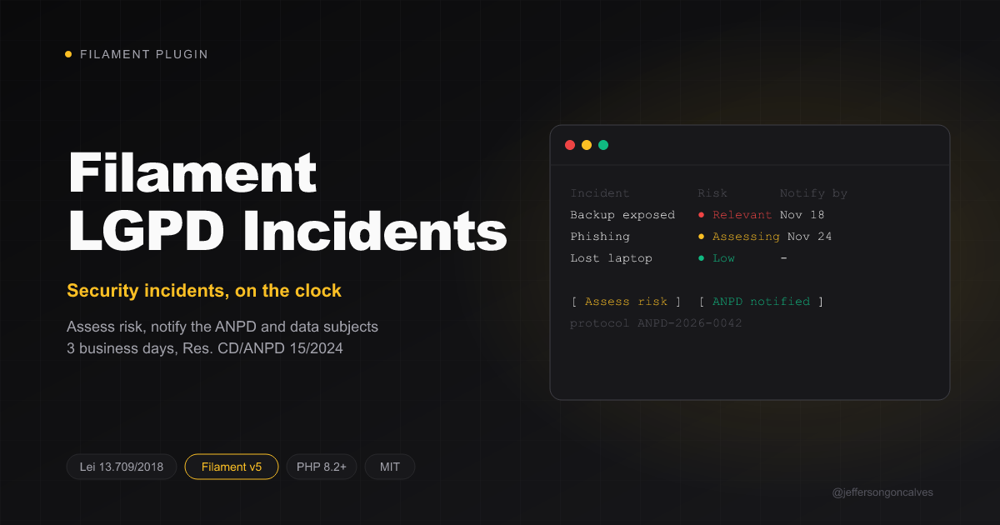

<div class="filament-hidden">



</div>

# Filament LGPD Incidents

[](https://packagist.org/packages/jeffersongoncalves/filament-lgpd-incidents)
[](https://github.com/jeffersongoncalves/filament-lgpd-incidents/actions?query=workflow%3Atests+branch%3A2.x)
[](https://github.com/jeffersongoncalves/filament-lgpd-incidents/actions?query=workflow%3A"Fix+PHP+code+styling"+branch%3A2.x)
[](https://packagist.org/packages/jeffersongoncalves/filament-lgpd-incidents)
[](LICENSE.md)

The Filament panel for [laravel-lgpd-incidents](https://github.com/jeffersongoncalves/laravel-lgpd-incidents): register security incidents involving personal data and keep the 3-business-day deadline to notify the ANPD and the data subjects in sight (Resolução CD/ANPD 15/2024).

## Features

- Register an incident: the deadline is set from the discovery date, skipping weekends and Brazilian holidays. The discovery date is locked afterwards.
- **Assess risk** (low or relevant). An incident assessed as low risk doesn't need to be communicated.
- Record the **ANPD notification** (with protocol) and the **data subject notification**, then **close** with the measures taken.
- Status badge (open, notification pending, overdue, closed), "Notification pending" and "Overdue" filters, and a navigation badge with pending incidents (red when one is overdue).
- 19 languages.

## Compatibility

| Plugin Version                                                                | Filament |
|-------------------------------------------------------------------------------|----------|
| [1.x](https://github.com/jeffersongoncalves/filament-lgpd-incidents/tree/1.x) | 3.x      |
| [2.x](https://github.com/jeffersongoncalves/filament-lgpd-incidents/tree/2.x) | 4.x      |
| [3.x](https://github.com/jeffersongoncalves/filament-lgpd-incidents/tree/3.x) | 5.x      |

## Installation

You can install the package via composer:

```bash
composer require jeffersongoncalves/filament-lgpd-incidents:"^2.0"
php artisan vendor:publish --tag="lgpd-incidents-migrations"
php artisan migrate
```

## Usage

```php
use JeffersonGoncalves\Filament\LgpdIncidents\LgpdIncidentsPlugin;

public function panel(Panel $panel): Panel
{
    return $panel
        ->plugins([
            LgpdIncidentsPlugin::make()
                ->navigationGroup('LGPD')             // default: no group
                ->navigationSort(40)
                ->navigationIcon('heroicon-o-exclamation-triangle')
                ->slug('incidents'),
        ]);
}
```

All fluent methods are optional. The deadline (3 or 6 business days) is configured in laravel-lgpd-incidents' `lgpd-incidents` config. Schedule `lgpd:incidents-overdue` to be alerted outside the panel.

> The resource has no authorization of its own: register it only on panels whose users handle incidents, or add a policy for `JeffersonGoncalves\LgpdIncidents\Models\Incident`. Records younger than 5 years can't be deleted.

## Testing

```bash
composer test
```

## Changelog

Please see [CHANGELOG](CHANGELOG.md) for more information on what has changed recently.

## Contributing

Please see [CONTRIBUTING](.github/CONTRIBUTING.md) for details.

## Security Vulnerabilities

Please review [our security policy](../../security/policy) on how to report security vulnerabilities.

## Credits

- [Jefferson Gonçalves](https://github.com/jeffersongoncalves)
- [All Contributors](../../contributors)

## License

The MIT License (MIT). Please see [License File](LICENSE.md) for more information.
